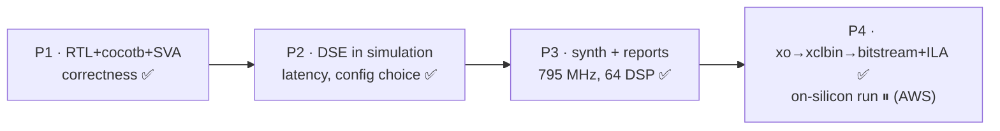

# gemm_kernelgen — workload-aware INT8 systolic GEMM with a generator and a flow down to ILA

A parameterized **INT8 systolic MAC array** in SystemVerilog, plus a **Python generator/autotuner** that
emits configurations, checks their correctness and measures performance in real simulation, plus an
**end-to-end FPGA flow** from RTL through synthesis, timing closure and Vitis kernel packaging to a
bitstream for AWS F2 with a System ILA.
Personal reference project: hardware acceleration of dense matmul for a specific workload, with
algorithm↔hardware co-design.

> Every number is labeled by its source: **latency is measured in simulation**, **f_max/DSP/LUT/power come
> from synthesis (Vivado)**. An on-silicon run on a live F2 is **deferred** (it needs a full AWS account with
> FPGA permissions); the F2 bitstream is built and contains the ILA. No estimate is presented as a measurement.

**Status:** P1–P3 done and verified. P4: packaging, linking and the F2 bitstream (with ILA) are built, and the
datapath logic is proven in simulation (cocotb AXI memory model); the on-silicon `PASS` waits for AWS FPGA access.

Written with AI assistance; architecture, specification and verification decisions are mine.

## What's inside

```
rtl/       pe.sv · systolic_array.sv · gemm_kernel.sv          (core + Vitis wrapper)
tb/        test_systolic.py · test_eval.py · test_kernel.py · systolic_sva.sv  (cocotb + SVA)
ref/       golden.py                                           (matmul reference)
gen/       generator.py · evaluate.py · search.py · ai_propose.py  (DSE loop)
flow/      synth.tcl · package_kernel.tcl · kernel.xml · build_hw.sh · ila_debug.tcl
host/      run_hw.py                                           (XRT host)
scripts/   Makefile · run.sh                                   (orchestration)
docs/      style_notes · report_analysis · flow_walkthrough · cloud_setup · cloud_runbook · synth_results_f2
```

## Architecture (dataflow)

Output-stationary: activation `a` moves right, operand `b` moves down, PE(i,j) holds `C[i][j]`.
Systolic skew: the pair `(A[i][k], B[k][j])` meets in PE(i,j) on cycle `k+i+j`, so latency is deterministic.

```
        b0   b1   b2   b3            (B from the top, skewed per column)
         │    │    │    │
  a0 ── PE─→ PE─→ PE─→ PE            PE = INT8 MAC, acc += a*b
         ↓    ↓    ↓    ↓            a → right (registered), b → down (registered)
  a1 ── PE─→ PE─→ PE─→ PE
         ↓    ↓    ↓    ↓
  a2 ── PE─→ PE─→ PE─→ PE            after (K-1)+(M-1)+(N-1)+1 cycles
         ↓    ↓    ↓    ↓            every acc(i,j) = C[i][j]
  a3 ── PE─→ PE─→ PE─→ PE
```

A full GEMM (M,N,K) is tiled on a `ceil(M/ARRAY_M)×ceil(N/ARRAY_N)` grid; the generator picks
`ARRAY_M×ARRAY_N` under a PE budget to maximize throughput.

## Project pipeline



## P3 synthesis result (8×8, VU47P-3, out-of-context)

| metric | value | source |
|---|---|---|
| **f_max** | **~795 MHz** (WNS +0.242 ns @ 1.5 ns, hold +0.052) | Vivado synth |
| **DSP** | **64** (= number of PEs, 1 MAC = 1 DSP48) | Vivado synth |
| LUT / FF | **16 / 384** (almost the whole MAC sits inside the DSP) | Vivado synth |

Timing was pushed **397 → 795 MHz** over four "read the critical path → fix it" iterations: OOC synthesis,
`use_dsp` (move the multiplier from LUTs into DSPs), MAC pipelining (latency↔f_max), and a synchronous reset
(the async reset blocked register packing into the DSP). After DSP packing the fabric is nearly empty
(16 LUT / 384 FF) and the design is route-bound at the DSP48E2 limit. Full numbers:
[docs/synth_results_f2.md](docs/synth_results_f2.md); walk-through of the iterations:
[docs/report_analysis.md](docs/report_analysis.md) (worked example).
⚠️ This is the OOC ceiling of the array; inside a Vitis kernel on F2 the kernel clock is lower (set by the platform).

## Running

**Locally (needs a Python venv with cocotb + Verilator on PATH):**
```bash
source "$FPGA_VENV/bin/activate"           # your venv with cocotb
./scripts/run.sh sim                       # P1: self-check + coverage + SVA
./scripts/run.sh dse                       # P2: DSE grid + hill-climb → results/dse.json
cd scripts && make kernel                  # AXI kernel: full DMA datapath vs golden
#   make kernel ARRAY_M=8 ARRAY_N=8 KERNEL_K=8
```
`make kernel` verifies the FULL wrapper (AXI-Lite control + AXI-master DMA + systolic array + result
collection + write-back) in simulation against the golden model, catching datapath bugs BEFORE an expensive
F2 bring-up. Checked on 4×4, 2×6, 6×3, 8×8 and several values of K.

**In the cloud (P3–P4, Vivado/Vitis + F2), all from the terminal, no GUI:**
exact command sequence → [docs/cloud_runbook.md](docs/cloud_runbook.md);
instance setup → [docs/cloud_setup.md](docs/cloud_setup.md);
detailed flow + headless ILA → [docs/flow_walkthrough.md](docs/flow_walkthrough.md).

## DSE result (example: GEMM 64×64×64, budget 64 PEs)

| config | PE | latency (sim) | MAC/cycle (model) | MAC/cycle/PE |
|---|---|---|---|---|
| 8×8 | 64 | 24 | **170.7** | 2.67 |
| 4×8 | 32 | 20 | 102.4 | 3.20 |
| 4×4 | 16 | 16 | 64.0 | 4.00 |
| 2×2 | 4 | 12 | 21.3 | **5.33** |

The classic trade-off: more PEs give higher absolute throughput but lower per-PE efficiency (fill/drain plus
latency). Latency is **measured in simulation** and includes the 3-stage MAC pipeline (see `rtl/pe.sv`);
MAC/cycle is computed from it with the sequential-tile model. Reproduce with `./scripts/run.sh dse`.

## Metrics by source (honesty)
| Metric | Source | Status |
|---|---|---|
| tile latency | Verilator sim (P2) | ✅ measured, deterministic |
| throughput, MAC/cycle | model (tiles × latency) | ✅ computed from measurements |
| f_max, DSP/LUT | Vivado synth (P3) | ✅ synthesis, not a measurement |
| datapath correctness (AXI DMA) | cocotb AXI model (P4) | ✅ proven in simulation |
| F2 bitstream (+ILA) | v++ (P4) | ✅ built |
| GEMM on silicon | XRT on F2 (P4) | ⏸ deferred (needs AWS FPGA access) |

## Stack
SystemVerilog · Verilator · cocotb · Python · Vivado/Vitis · XRT · AWS F2/Alveo.
RTL style follows lowRISC ([docs/style_notes.md](docs/style_notes.md)).
